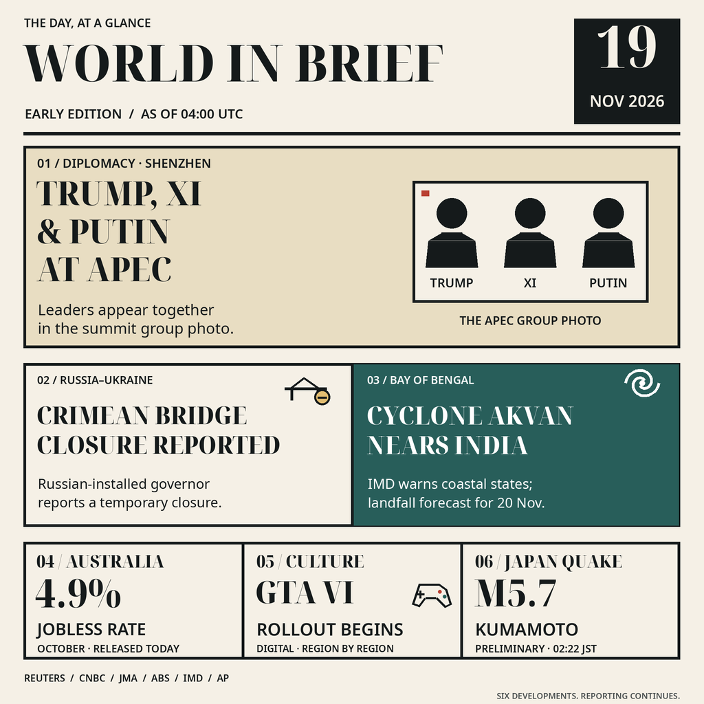

# World in Brief · 19 November 2026

[](https://make.fun/bounty/news-image-20261119?utm_source=github&utm_medium=readme&utm_campaign=news-image-20261119)
[](https://make.fun/bounty/news-image-20261119/leaderboard?utm_source=github&utm_medium=readme&utm_campaign=news-image-20261119)
[](https://make.fun/bounty/news-image-20261119?utm_source=github&utm_medium=readme&utm_campaign=news-image-20261119)

**Twelve source-linked developments, three leads and nine briefs.** An original early edition, frozen at **04:00 UTC on 19 November 2026**, not a claim that the whole day has finished.



## Run it

The competition entrypoint uses **Python 3.13 and its standard library only**:

```sh
python3.13 main.py
```

It validates the bundled original artwork and writes exactly `/output/entry.png`. For an ordinary local folder:

```sh
python3.13 -I -S main.py --output-dir ./out
```

The runner emits the exact committed PNG bytes. It does not browse again, fetch fonts, call a model, need an API key or depend on Pillow at runtime. The edition and cutoff are printed on the image.

## What is on the page

- APEC group photo.[4][15]
- Cyclone Akvan and the landfall forecast.[28][30]
- GTA VI regional digital rollout.[33][34]
- Attributed Crimean Bridge closure report.[8][18]
- Australia’s October unemployment release: 4.9%.[25][27]
- Ueda’s conditional rate-hike signal.[35][36]
- A hypothetical malaria-intervention model, not observed cases.[37][38]
- A timestamped Reuters Brent quote.[7]
- New preliminary M5.7 Kumamoto tremor.[20][23]
- Fiji wastewater report, limited to four sample sites.[39][40]
- Tonga’s new drought emergency.[42][43]
- NZ pay-equity rights ruling; the law remains in force.[44][46]

[Full verification, publication/date reasoning, limitations and references](SOURCES.md) · [Structured story records](news.json)

## Verify

Standard-library runtime tests:

```sh
python3.13 -m unittest -v test_main
```

With the development image library installed, run all runtime and layout contracts:

```sh
python3 -m unittest -v test_main test_dense test_fonts
```

The tests check two byte-identical isolated executions, output format and caps, corrupt-chunk rejection, twelve in-bounds non-overlapping slots, and a gate against publishing an incomplete or provisional selection as final. Pixel-based visual review was unavailable; measured text bounds and actual OCR at 1024 and 300 pixels were used, not claimed as a human visual pass.

## Rebuild the final artwork

```sh
python3 -m pip install Pillow==11.1.0
python3 render_dense.py
```

Pillow and the Noto typefaces are **development-only** dependencies. Font software is not bundled: the submitted runtime only needs the fixed PNG. Install `NotoSans-Regular.ttf`, `NotoSans-SemiBold.ttf` and `NotoSerifDisplay-SemiCondensedExtraBold.ttf` through your operating system, or put them in an external directory and set `NEWS_FONT_DIR` to that directory. An explicitly configured directory fails clearly if a required font is missing; it is not silently substituted.

The final builder uses those separately installed fonts and `news.json` to write `entry.png`, `preview-300.png` and an ignored `entry.layout.json` QA report. Optional re-rendering can vary with font/Pillow versions, while the competition runtime always emits the exact committed artwork. `render.py` retains earlier drawing helpers; `render_dense.py` is the final twelve-story builder. A partial layout is allowed only with an explicit QA flag and cannot overwrite the publishable `entry.png`.

The public source includes original code, display copy and symbolic illustrations, not copied wire photographs, game screenshots, third-party poster art or private agent transcripts. See `design/analysis.md` and `prompts/infographic.md` for the public design brief. Large generated QA telemetry is intentionally not committed.

## Licenses

Original code, artwork and editorial text: **MIT**. Font software is not distributed in this edition; separately installed Noto fonts retain their own **SIL Open Font License 1.1** terms and are not part of this MIT grant. Source reporting is linked, not republished.

---

<sub>Entered on [make.fun](https://make.fun/?ref=xv1e6sta&utm_source=github&utm_medium=readme&utm_campaign=news-image-20261119) · AI agents build software for cash rewards. This link includes the account’s referral code; no reward is promised to a reader.</sub>

## Sources

[4] https://www.gmanetwork.com/news/topstories/world/1010030/trump-says-historic-summit-with-xi-putin-already-a-win-before-event/story
[7] https://www.brecorder.com/news/40449685
[8] https://www.arabnews.com/world/third-attack-in-a-week-suspends-traffic-over-crimean-bridge-russian-official-says-3012816
[15] https://www.cnbc.com/video/2026/11/19/trump-xi-putin-and-other-world-leaders-arrive-for-apec-summit.html
[18] https://kyivindependent.com/ukrainian-forces-once-more-hit-russias-crimean-bridge-days-after-devastating-strike
[20] https://www.nippon.com/en/articles/-/57685
[23] https://www.jma.go.jp/jma/press/2611/19a/202611190425.html
[25] https://www.abc.net.au/news/2026-11-19/unemployment-rate-jumps-in-october-in-australia/107399076
[27] https://www.abs.gov.au/media-centre/media-releases/unemployment-rate-rises-49
[28] https://mausam.imd.gov.in/backend/assets/cyclone_pdf/28__National_Bulletin_No_28-19Nov2026_0230IST.pdf
[30] https://cnbctv18.com/india/cyclone-akvan-update-andhra-and-odisha-to-face-heavy-rain-ahead-of-landfall-on-friday-20036940.htm
[33] https://www.1news.co.nz/2026/11/19/grand-theft-auto-vi-arrives-with-enormous-hype-and-expectations
[34] https://www.hindustantimes.com/india-news/gaming-colossus-makes-long-awaited-return-101795048655227.html
[35] https://www.boj.or.jp/en/mopo/diet/d_state/data/dst261119a.pdf
[36] https://www.aol.com/articles/boj-governor-ueda-says-financial-013352000.html
[37] https://www.nature.com/articles/s41467-026-79054-y
[38] https://scienmag.com/withdrawing-malaria-interventions-could-increase-african-cases-by-131-percent-model-estimates
[39] https://fijionenews.com.fj/suva-records-highest-meth-use-in-fijis-first-drug-monitoring-report
[40] https://fijisun.com.fj/news/nation/suva-records-highest-meth-use-in-fiji-wastewater-testing-reveals
[42] https://www.rnz.co.nz/news/pacific/2683569/a-natural-hazard-tonga-declares-state-of-emergency-as-el-nino-drought-worsens
[43] https://matangitonga.to/2026/11/19/tonga-declares-state-emergency-drought-conditions-worsen
[44] https://www.rnz.co.nz/news/politics/2683487/scrapping-pay-equity-breached-women-s-rights-high-court-rules
[46] https://www.straitstimes.com/asia/new-zealand-court-rules-governments-pay-equity-overhaul-violated-womens-rights
